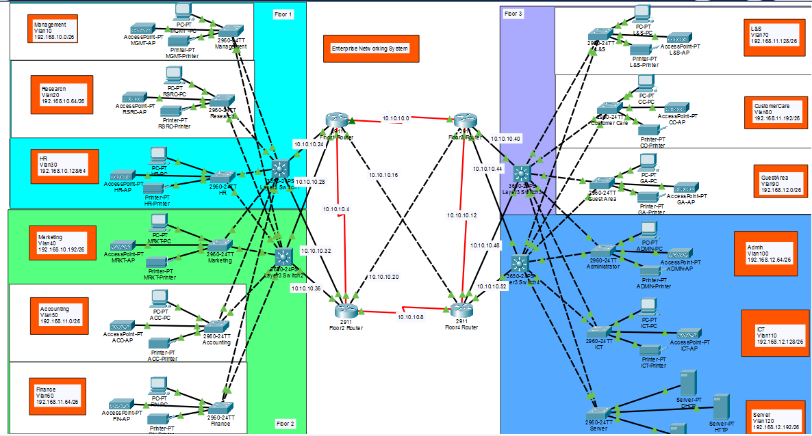
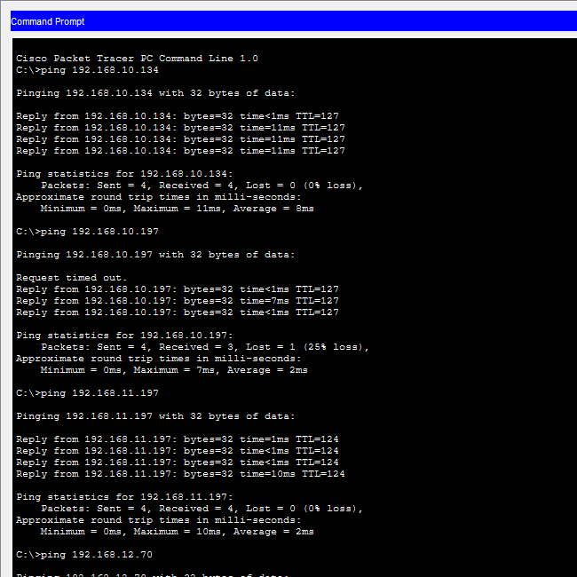
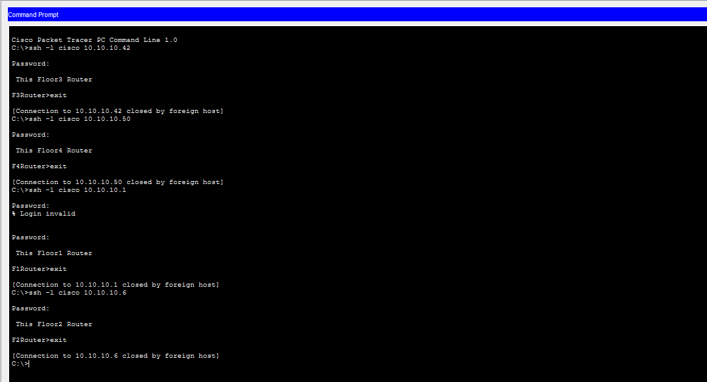

# Enterprise Networking System (Cisco Packet Tracer)

A four-floor enterprise network built in Cisco Packet Tracer. Each floor has its own Layer 3 switch and router, each department has its own VLAN, and a central DHCP server in the server room gives out IP addresses to the whole building.

## Topology



## Devices

| Floor | Router | Layer 3 Switch | Departments |
|-------|--------|----------------|-------------|
| 1 | Floor1 Router (2911) | Layer3 Switch1 (3650-24PS) | Management, Research, HR |
| 2 | Floor2 Router (2911) | Layer3 Switch2 (3650-24PS) | Marketing, Accounting, Finance |
| 3 | Floor3 Router (2911) | Layer3 Switch3 (3650-24PS) | Logistics & Store, Customer Care, Guest Area |
| 4 | Floor4 Router (2911) | Layer3 Switch4 (3650-24PS) | Administrator, ICT, Server Room |

Every department has its own 2960-24TT switch with a PC, a printer, and an access point for Wi-Fi. The Server Room hosts the DHCP and HTTP servers.

## VLANs

The full IP addressing plan (networks, masks, host ranges, and broadcast addresses) is in [`ip-addressing.docx`](ip-addressing.docx). All department networks are /26 subnets of 192.168.10.0, and all router and switch links are /30 subnets of 10.10.10.0.

| Floor | Department | VLAN | Network |
|-------|------------|------|---------|
| 1 | Management | 10 | 192.168.10.0/26 |
| 1 | Research | 20 | 192.168.10.64/26 |
| 1 | HR | 30 | 192.168.10.128/26 |
| 2 | Marketing | 40 | 192.168.10.192/26 |
| 2 | Accounting | 50 | 192.168.11.0/26 |
| 2 | Finance | 60 | 192.168.11.64/26 |
| 3 | Logistics & Store | 70 | 192.168.11.128/26 |
| 3 | Customer Care | 80 | 192.168.11.192/26 |
| 3 | Guest Area | 90 | 192.168.12.0/26 |
| 4 | Administrator | 100 | 192.168.12.64/26 |
| 4 | ICT | 110 | 192.168.12.128/26 |
| 4 | Server Room | 120 | 192.168.12.192/26 |

## Features

- **VLANs:** each department is in its own VLAN.
- **Inter-VLAN routing:** each Layer 3 switch routes between its floor's VLANs.
- **OSPF:** the routers and Layer 3 switches share routes, so every network can reach every other network.
- **Redundancy:** the routers are linked to each other, and each Layer 3 switch connects to two routers, so traffic has more than one path.
- **Central DHCP:** the DHCP server in the Server Room gives IP addresses to all floors, using DHCP relay on each Layer 3 switch.
- **Wi-Fi:** each department has an access point for wireless devices.
- **SSH:** all routers allow secure remote login.

## Testing

- PCs on one floor can ping PCs on the other floors.
- PCs receive their IP addresses from the DHCP server automatically.
- SSH login works to all four routers (each shows its own floor banner).




## Repository Contents

```
.
├── README.md
├── project5.pkt
├── ip-addressing.docx
└── images/
    ├── topology.png
    ├── ping-test.png
    └── ssh-test.png
```

## How to Open

Open `project5.pkt` with Cisco Packet Tracer.
